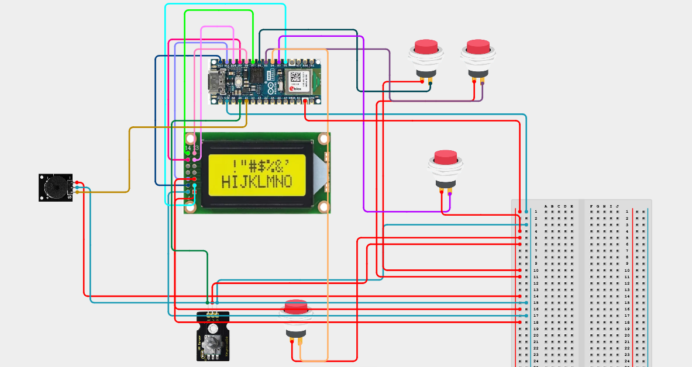

# Horloge Pomodoro
Principalement pensée pour les étudiants et les personnes ayant un TDAH (Trouble du déficit d’attention avec hyperactivité), cette horloge Pomodoro est conçue pour encourager la productivité et les distractions par les écrans et les réseaux sociaux.

*Diagrame réalisé avec Cirkit Design*
#### Qu'est-ce que la technique Pomodoro?
La technique Pomodoro est une méthode de gestion de temps qui cycle entre des périodes de travail et de pause. Traditionnellement, un Pomodoro est composé de 25 minutes de travail concentré suivi d'une courte pause. Lorsque la pause est terminée, une nouvelle période de travail commence. Cependant, la durée de chaque période peut être personnalisée selon les besoins de l’utilisateur.
## Matériel
* x1 Arduino Nano ESP32 avec des headers
* x4 Button switch avec 2 pins
* x1 breadboard
* x1 module LCD 8x2
* x1 buzzer passif
* x1 potentiomètre
## Instructions
## Crédits et mentions
### Équipe
**Camille Leclerc** - Rôle
**Sarah Ouakil** - Rôle
### Déclaration d’utilisation de l’IA
Avec l’accord de la personne enseignante, un outil d’intelligence artificielle générative (Claude, version [version]) a été utilisé dans le cadre de ce projet pour [principaux usages ici]. Tout contenu généré a été vérifié, corrigé et validé par l’équipe.